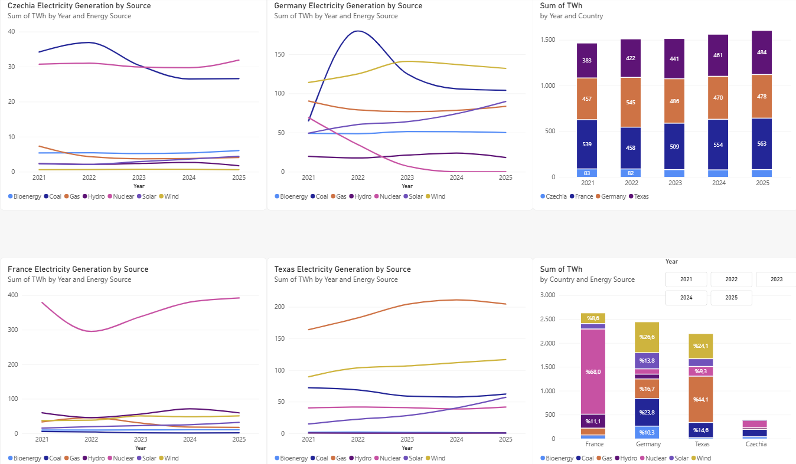

# Electricity Markets and Industrial Site Selection, 2021–2025

Where should a manufacturer locate a plant that needs electricity around the clock? Would the answer change if it could shift production by a few hours? We compared Czechia, Germany, France, and the ERCOT market in Texas over five years using Excel, Power BI, and published market reports.

**Our assessment:** France was the strongest candidate for continuous production, provided nuclear availability holds. Texas could offer lower costs to a flexible plant that can move consumption into cheaper hours and has a supply contract that passes those prices through. We assigned medium confidence to this assessment. An individual site's grid connection, network charges, and contract terms can change the ranking.

## What shaped the comparison

| Evidence | Why it matters to a manufacturer |
| --- | --- |
| In 2022, the European gas crisis coincided with reduced French nuclear availability. The dashboard shows French generation falling from about 539 TWh in 2021 to 458 TWh in 2022, then recovering to 509 TWh in 2023. | A plant running continuously remains exposed during supply shortages. The availability of the generation fleet matters alongside its usual mix. |
| Winter Storm Uri disrupted the Texas market in 2021. In other periods, abundant renewable output can create low or negative wholesale prices. | The value of flexibility depends on which hours a plant can avoid and how much production it can reschedule. An annual average hides that difference. |
| Transmission bottlenecks can limit delivery even when power is plentiful elsewhere. | A location comparison needs local network conditions and delivered costs alongside wholesale prices. |

## Explore the analysis

1. **Read the [competitive intelligence report](4IT566%20Competitive%20Intelligence%201.pdf)** for the market evidence, sources, and reasoning behind the two location scenarios.
2. **Open the [electricity price workbook](electricity_prices_CZ_DE_FR_TX_2021_2025_PowerBI%281%29.xlsx)** to explore the monthly series and yearly comparisons. Check the workbook notes for the units and currency before comparing price levels.
3. **Open the [generation workbook](testExcel2_PowerBI_ready_Texas_filled%281%29.xlsx)** for the market-level sheets and the combined PowerBI_Data table used to visualize generation by source.

## Power BI dashboard

The preview shows how the generation mix changed in each market and how total output compared across markets. Generation is measured in terawatt-hours (TWh). The price series are in the separate workbook linked above.

## Authors

Cem Temel and Keyur Girishbhai Vithlani · 4IT566 Competitive Intelligence · Prague University of Economics and Business (VŠE) · October 2026
